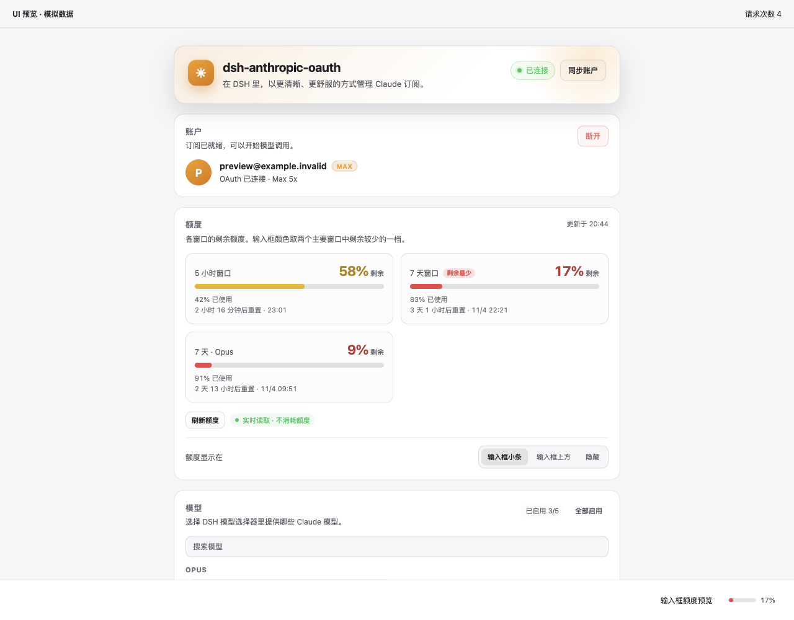

# dsh-anthropic-oauth

**Use your Claude subscription in DeepSeek Harness. Sign in, choose models, and check quota without leaving DSH.**

[中文说明](README.zh.md) · [Changelog](CHANGELOG.md) · [Live verification](docs/live-verification-2026-11-06.md) · [Report an issue](https://github.com/drewliu123/dsh-anthropic-oauth/issues)

[](https://github.com/drewliu123/dsh-anthropic-oauth/actions/workflows/ci.yml)
[](LICENSE)

Connect a Claude Pro/Max account in Settings, enable the models you want, and return to your conversation. A composer meter shows remaining allowance; open it for usage windows and reset times. You can also choose to reuse an existing Claude Code login.



*This preview uses the actual plugin components with simulated account and quota data.*

> **Verified with a real account.** On 2026-11-06, plugin `0.1.2` completed OAuth login, token refresh, Claude Haiku 5.5 inference, and read-only quota retrieval through DSH `0.2.1-rc.5`. [See the environment and results](docs/live-verification-2026-11-06.md).

## Everyday use

| What you want to do | What the plugin provides |
| --- | --- |
| Connect an account | Start browser authorization, adopt a local Claude Code login, sync account state, or disconnect from Settings. |
| Choose models | Discover your account's models, browse families such as Opus / Sonnet / Haiku, search, enable or disable, and set a default. The current default and last enabled model cannot be switched off directly. |
| Check allowance | Use a composer meter, a dock above the input, or Settings. Details show remaining percentages, reset times, and data sources. You can also hide the composer display. |

The UI supports English and Chinese, light and dark themes, and narrow screens. The meter follows the primary window with the lowest remaining percentage; additional windows, such as Opus-specific usage, appear separately in Settings.

## Installation

Have **Node.js 24 LTS, Git, and pnpm on your `PATH`**, plus a Claude Pro/Max account. The plugin code supports Node 20+, but Node 24 also meets the newer DSH CLI requirements.

### First run: a separate Web instance

These commands use the verified DSH version and separate both DSH configuration and Claude credentials from your usual setup. Run them in the same terminal; a global DSH installation is not required.

```bash
git clone https://github.com/drewliu123/dsh-anthropic-oauth.git
cd dsh-anthropic-oauth

export DSH_HOME="$PWD/.dsh-dev"
export DSH_ANTHROPIC_OAUTH_CLAUDE_DIR="$DSH_HOME/claude-home"

npx -y -p @deepseek-ai/dsh@0.2.1-rc.5 dsh plugin --profile web add "$PWD"
npx -y -p @deepseek-ai/dsh@0.2.1-rc.5 dsh --profile web --port 3187 --no-open
```

Open the **complete access URL printed in the terminal**, then go to **Settings → dsh-anthropic-oauth**. The bundle registers automatically; no manual YAML patch is needed. Keep the same environment variables for later launches.

1. Click **Sign in**, finish authorization on Claude's page, and return to DSH. Use the waiting banner's fallback link if the tab did not open.
2. Enable the models you want. DSH builds with the default-model service show **Make default**; you can also select an enabled model in the conversation picker.
3. Open a conversation and select a Claude model to see its quota status beside the input. Change the display placement in the plugin's Settings page.

You have fifteen minutes to complete each sign-in; the waiting banner shows the deadline. If that window expires, close the old consent tab and start a new sign-in.

### Existing DSH or Claude Code setups

For a CLI-managed Web instance, run the add command from the repository root with that instance's `DSH_HOME`, replace `web` with its profile name, and restart the original instance. **Installation and launch must use the same home/profile.** The first-run commands above create a separate instance. The desktop app's `desktop` profile is reserved and cannot be managed by the ordinary npm CLI; use the desktop app's supported plugin-management path.

To reuse your usual Claude Code login, unset `DSH_ANTHROPIC_OAUTH_CLAUDE_DIR` when launching DSH, or point it at the intended directory. Path precedence is `DSH_ANTHROPIC_OAUTH_CLAUDE_DIR` → `CLAUDE_CONFIG_DIR` → `~/.claude`. A detected session is adopted only after you click **Use Claude Code login**. The isolated first-run directory will normally not detect your usual login.

To update, run `git pull --ff-only` from the repository root, repeat the add command for the original home/profile if needed, and restart DSH.

## Does reading quota consume allowance?

**Automatic reads do not send inference requests.** The plugin first tries a read-only usage endpoint and labels the source in the UI. Missing or invalid data produces a not-read/retry state rather than a false zero-usage reading.

If the read-only endpoint is unavailable, an explicit manual refresh can send one minimal `max_tokens: 1` request and read the rate-limit headers. That consumes a small amount of allowance; probe results are cached for five minutes. The composer meter appears only while a Claude model is selected in the current conversation.

## Accounts and credentials

OAuth exchange and token refresh run on the DSH host. Account status omits token values. Credentials are synchronized to DSH's credential service and are not copied to a third-party subscriptions store.

**Cancel** ends the pending authorization. **Disconnect** clears the DSH connection and credential references and stops pending authorization, while retaining Claude Code's credential file. Sign-in and refresh use the selected credential directory and may update its shared file, so isolate both DSH and Claude directories when testing another account.

The bundled `anthropic-oauth-login` CLI honors the same path settings and writes secret files with owner-only permissions. The Settings flow is the recommended entry point.

## Troubleshooting

<details>
<summary>Installation, authorization, models, and quota</summary>

| What you see | What to check |
| --- | --- |
| Plugin missing from Settings | Confirm that installation and launch use the same home/profile, then restart DSH to rebuild the client bundle. |
| Sign-in tab did not open | Use the waiting banner's fallback link. The callback must reach the machine running DSH. |
| Sign-in expired or callback connection refused | Close the old consent tab and start a new sign-in from Settings. |
| Claude's Authorize button stays disabled | Complete any human verification on Claude's page. Reaching consent does not by itself complete authorization. |
| Models are missing | Use **Sync account**. Discovery failure preserves existing provider settings; the plugin does not invent model IDs. |
| No composer meter | Select a Claude model and check that placement is not **Hidden**. Quota may not have been read yet. |
| No **Make default** button | Your DSH build does not expose the default-model service. Use DSH's model picker. |
| Quota needs a manual read | Retry the read-only source first, or use the manual probe if you accept its small allowance cost. |

For an issue report, include DSH/Node versions, the profile name, steps to reproduce, and a redacted screenshot or error. Do not include credential files or authorization URLs.

</details>

## Development and testing

There are no root runtime dependencies to install:

```bash
npm run check
npm test
npm pack --dry-run
```

Automated tests use temporary stores and mocked provider responses to cover credential isolation, OAuth callbacks and deadlines, model settings, quota parsing, and client registration. Real-account integration is documented separately in the [verification record](docs/live-verification-2026-11-06.md).

To preview the actual UI with synthetic data:

```bash
cd dev/preview
npm ci
npm start
```

Open `http://127.0.0.1:3191`. For example, `?theme=light&lang=en&scenario=error` shows a light English error state. See the [validation guide](docs/validation.md) for other scenarios and coverage.

## License

Released under the [MIT License](LICENSE).

[Acknowledgments](NOTICE.md) · [Design notes](DESIGN.md)
