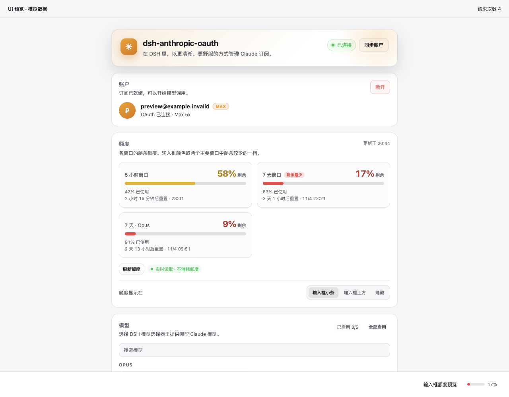

# dsh-anthropic-oauth

**把 Claude 订阅接入 DeepSeek Harness，登录、选模型、看额度都在 DSH 里完成。**

[English](README.md) · [更新记录](CHANGELOG.md) · [真实验证记录](docs/live-verification-2026-11-06.md) · [反馈问题](https://github.com/drewliu123/dsh-anthropic-oauth/issues)

[](https://github.com/drewliu123/dsh-anthropic-oauth/actions/workflows/ci.yml)
[](LICENSE)

在设置页连接 Claude Pro/Max 账户，选好要用的模型，就可以回到 DSH 对话。剩余额度显示在输入框旁，展开即可查看用量窗口和重置时间。已有 Claude Code 登录时，也可以主动选择复用。



*界面预览使用实际插件组件，账户和额度为模拟数据。*

> **已通过真实账号验证。** 2026-11-06，插件 `0.1.2` 在 DSH `0.2.1-rc.5` 中跑通 OAuth 登录、Token 刷新、Claude Haiku 5.5 推理和只读额度读取。[查看环境与结果](docs/live-verification-2026-11-06.md)。

## 日常使用

| 你要做的事 | 插件提供的操作 |
| --- | --- |
| 连接账户 | 在设置页发起浏览器授权、复用已有 Claude Code 登录、同步账户或断开连接。 |
| 选择模型 | 从账户获取可用模型，按 Opus / Sonnet / Haiku 等系列分组；支持搜索、启停和设为默认。当前默认模型和最后一个已启用模型不能直接停用。 |
| 查看额度 | 在输入框小条、输入框上方或设置页查看；展开后可见各窗口的剩余比例、重置时间和数据来源。也可以隐藏对话中的额度显示。 |

界面支持中英文、深浅色主题和窄屏布局。额度小条采用主要窗口中剩余比例较少的一档；供应商返回的 Opus 等额外窗口在设置页单独展示。

## 安装

准备好 **Node.js 24 LTS、Git 和可在 `PATH` 中找到的 pnpm**，以及 Claude Pro/Max 账户。插件代码支持 Node 20+，这里推荐 Node 24 是为了同时满足 DSH CLI 的运行要求。

### 首次试用：启动独立 Web 实例

下面使用已实测的 DSH 版本，同时隔离 DSH 配置与 Claude 凭据。请在同一个终端中执行，无需全局安装 DSH：

```bash
git clone https://github.com/drewliu123/dsh-anthropic-oauth.git
cd dsh-anthropic-oauth

export DSH_HOME="$PWD/.dsh-dev"
export DSH_ANTHROPIC_OAUTH_CLAUDE_DIR="$DSH_HOME/claude-home"

npx -y -p @deepseek-ai/dsh@0.2.1-rc.5 dsh plugin --profile web add "$PWD"
npx -y -p @deepseek-ai/dsh@0.2.1-rc.5 dsh --profile web --port 3187 --no-open
```

打开终端输出的**完整访问网址**，进入 **设置 → dsh-anthropic-oauth**。插件会自动注册，不需要手动修改 YAML。之后再次启动时，也要保留相同的环境变量。

1. 点击 **登录**，在 Claude 页面完成授权，再回到 DSH。弹窗没有打开时，使用等待提示中的备用链接。
2. 选择要启用的模型。支持默认模型服务的 DSH 会显示 **设为默认**，也可以直接在对话模型选择器中选择。
3. 新建或打开对话，选中 Claude 模型后，输入框旁就会显示额度状态；显示位置在插件设置页调整。

每次登录需在十五分钟内完成授权，等待提示中会显示截止时间。若已过期，请关闭旧授权页，重新点击 **登录**。

### 已有 DSH 或 Claude Code 登录

对于通过 CLI 管理的 Web 实例，在仓库根目录使用该实例的 `DSH_HOME` 执行添加命令，将 `web` 替换为实际 profile 名称，然后重启原实例。**安装和运行必须指向同一组 home/profile。** 上面的试用命令会创建独立实例；桌面应用的 `desktop` 是保留 profile，普通 npm CLI 不能直接管理，应使用桌面版支持的插件管理方式。

要复用日常 Claude Code 登录，请在启动 DSH 时取消 `DSH_ANTHROPIC_OAUTH_CLAUDE_DIR`，或把它指向相应目录。凭据目录的优先级为 `DSH_ANTHROPIC_OAUTH_CLAUDE_DIR` → `CLAUDE_CONFIG_DIR` → `~/.claude`。检测到已有登录后，点击 **使用 Claude Code 登录** 才会接管该会话。独立试用目录通常不会检测到你日常使用的登录。

更新时，在仓库根目录执行 `git pull --ff-only`，必要时向原 home/profile 重新执行添加命令，再重启 DSH。

## 额度读取会消耗用量吗？

**自动读取不发送推理请求。** 插件优先使用只读 usage 接口，并在界面注明来源；没有读到有效数据时，会显示待读取或重试状态，不会把错误当成零用量。

只读接口不可用时，手动刷新可触发一次 `max_tokens: 1` 的最小请求，从响应 Header 读取额度。这会消耗少量用量，探测结果缓存五分钟。对话中的额度小条只在当前选中 Claude 模型时出现。

## 账户与凭据

OAuth 交换和 Token 刷新在 DSH Host 侧完成，账户状态不包含 Token 值。凭据同步到 DSH 自身的凭据服务，不额外复制到第三方 subscriptions 存储。

**取消**会结束当前授权；**断开**会清除 DSH 连接与凭据引用，并终止待完成的授权，但保留 Claude Code 的凭据文件。登录和刷新会使用所选凭据目录，可能更新其中的共享文件，因此测试其他账户时应同时隔离 DSH 与 Claude 目录。

附带的 `anthropic-oauth-login` 命令行工具遵守相同的目录设置，凭据文件仅允许当前用户读写。推荐从设置页登录。

## 常见问题

<details>
<summary>安装、授权、模型与额度排查</summary>

| 现象 | 处理方式 |
| --- | --- |
| 设置中找不到插件 | 检查安装和运行实例的 home/profile 是否一致，重启 DSH 以重新构建客户端。 |
| 没有弹出登录页 | 点击等待提示中的备用链接。OAuth 回调需要能访问运行 DSH 的那台机器。 |
| 登录过期或回调连接被拒绝 | 关闭旧授权页，在设置中重新发起登录。 |
| Claude 的授权按钮一直灰色 | 在 Claude 网页完成所需的人机验证；打开授权页不代表已经授权成功。 |
| 模型列表为空 | 点击 **同步账户**。发现失败时保留原供应商设置，不会写入猜测的模型 ID。 |
| 输入框没有额度小条 | 确认选中 Claude 模型，显示位置未设为 **隐藏**；也可能尚未读到额度。 |
| 没有 **设为默认** 按钮 | 当前 DSH 未提供默认模型服务，可使用 DSH 自带模型选择器。 |
| 提示需要手动读取额度 | 先重试只读接口，接受少量用量消耗时再使用手动探测。 |

反馈时请附上 DSH/Node 版本、profile 名称、操作过程及脱敏截图或错误，不要上传凭据文件和授权链接。

</details>

## 开发与测试

根目录没有需要安装的运行时依赖：

```bash
npm run check
npm test
npm pack --dry-run
```

自动化测试使用临时目录与模拟供应商响应，覆盖凭据隔离、OAuth 回调与超时、模型设置、额度解析和客户端注册。真实账号验证单独记录在 [验证报告](docs/live-verification-2026-11-06.md) 中。

查看使用模拟数据的实际 UI：

```bash
cd dev/preview
npm ci
npm start
```

打开 `http://127.0.0.1:3191`。例如 `?theme=light&lang=en&scenario=error` 可查看浅色英文错误场景。更多场景和覆盖范围见 [测试说明](docs/validation.md)。

## 许可证

本项目采用 [MIT 许可证](LICENSE) 开源。

[致谢](NOTICE.md) · [设计说明](DESIGN.md)
